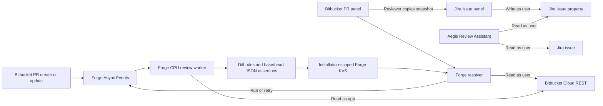

# Architecture

The PR panel derives the repository UUID, workspace ID and PR number from Forge's invocation context. The resolver reads the PR as the viewer before reading stored evidence or scheduling a job. The event handler accepts the two documented Forge payloads. The queue serializes runs by PR, and its consumer re-reads live metadata. A matching base/head pair reuses an existing result unless a reviewer explicitly asks to replace it. The previous attempt ID makes retried messages idempotent. Rate limits and server responses can trigger up to three application-level retries. The panel displays a local queued state after Forge accepts a manual request and refreshes while a review is active.

The worker obtains the PR diff and first diffstat page through Bitbucket. It only saves a completed report if the PR metadata still identifies the same revisions after retrieval. It reads the contract and compared JSON documents using immutable commit identifiers. The contract comes from the destination revision, so the proposed change cannot rewrite its own assertions. The verifier interprets a bounded set of JSON equality assertions and returns per-check statuses. It does not invoke a shell, install dependencies, or evaluate repository source code. This is a CPU path for versioned JSON artifacts and configuration.

Static rules cover unresolved merge markers, debugger statements, private-key headers and trailing whitespace in supported added diff lines. Evidence and static findings have separate displays. An unreadable head file produces an unavailable check. A pass-to-fail comparison is sufficient for a scoped regression even when another check is incomplete. The clean verdict requires all configured checks to pass on both revisions.

Forge KVS retains up to six attempts per PR for 30 days and drops older attempts sooner if needed to stay under its size limit. The store is scoped to an installation. PR metadata, changed filenames, static finding descriptions, and check statuses are stored. Diff bodies, checked JSON values and PR descriptions are transient.

Forge's standard required/optional multi-app compatibility supports Jira and Confluence. The second Forge app uses Jira's permission model instead of reading Bitbucket installation storage. An authorized reviewer shares a snapshot on a Jira issue referenced in the PR. The Jira resolver fetches the actual issue description, summary, and status. Rovo actions read the issue and saved snapshot as the requesting user. They return the reported results and provenance to the agent. The snapshot is a reviewer-shared copy and can be edited by someone with Jira edit access. The live Bitbucket panel is the source of record. [Forge app compatibility](https://developer.atlassian.com/platform/forge/app-compatibility/)

## Evidence workspace

The Forge apps use Atlassian-hosted runtime and storage. The companion Next.js and FastAPI workspace is an optional single-operator service. It stores data in its own SQLite database and keeps a local Ed25519 signing key. The workspace reads allowlisted GitHub PR diffs at pinned revisions, executes the committed fixture catalog, and can use optional advisory providers. A trusted fixture worker and ranking worker are separately configured.

A reviewer explicitly imports a Bitbucket JSON snapshot through the workspace UI. The importer validates the schema and per-assertion outcomes, records that the evidence was reviewer-supplied, and signs its stored copy. The local signature establishes the integrity of that copy. The Bitbucket report remains the source of record. [Workspace configuration](WORKSPACE.md)
